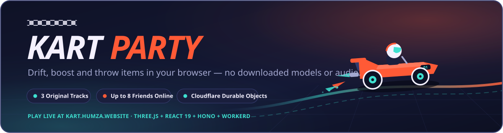
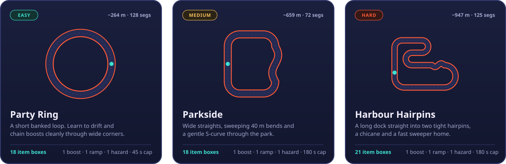
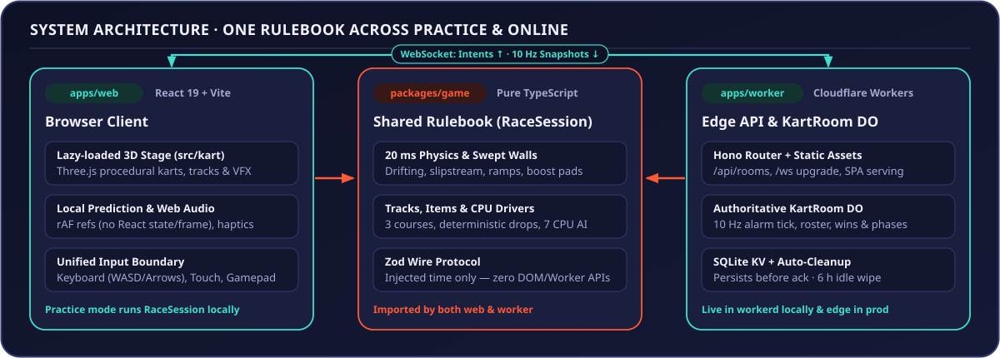

<div align="center">

<a href="https://kart.humza.website">
  
</a>

<br />

[](https://kart.humza.website)
[](https://www.typescriptlang.org/)
[](https://react.dev/)
[](https://threejs.org/)
[](https://developers.cloudflare.com/durable-objects/)

**An original, zero-asset browser kart racer.**
Drift, slipstream, glide off ramps, and throw items across three procedural tracks — solo against CPU rivals or online with up to eight friends on phones and laptops.

[Play Now](https://kart.humza.website) · [Tracks](#tracks) · [Gameplay & Mechanics](#gameplay--mechanics) · [Controls](#controls) · [Architecture](#architecture) · [Getting Started](#getting-started) · [Docs](docs/architecture.md)

</div>

---

> [!TIP]
> **Zero downloaded assets.** Every track ribbon, kart chassis, driver helmet, particle spark, and Web Audio engine synth is generated in code. The home page stays light because the 3D stage (`three`) is lazy-loaded only when a race starts.

## Highlights

- **Play Solo or Party Online** — Practise against `0–7` CPU drivers with browser-saved personal bests (`/practice`), or spin up a 4-letter online room (`/play`) for up to **8 human racers** plus CPU grid fillers.
- **One Shared Rulebook** — Practice and online rooms both run every race through [`RaceSession`](packages/game/src/session.ts). No duplicated physics loops, lap counters, or scoring paths.
- **Instant Feel + Authoritative Rooms** — Local client prediction makes steering feel immediate while the [`KartRoom`](apps/worker/src/room.ts) Durable Object ticks at **10 Hz**, persists state to SQLite KV before acknowledging actions, and cleans up idle rooms after 6 hours.
- **Built for Any Device** — Full keyboard, adaptive multi-touch mobile controls (thumb pad or slider, swappable sides, vibration haptics), and standard gamepad support with configurable sensitivity and deadzone.
- **Adaptive Graphics & Synthesised Audio** — Live frame-health probing scales pixel ratio and VFX budgets automatically (`Auto` / `High` / `Low`), paired with an opt-in Web Audio engine note and race chimes.

---

## Tracks

All three courses are original layouts built from shared geometry that drives the 3D road mesh, minimap, surface detection, and swept wall boundaries alike.

<div align="center">
  
</div>

| Track                | ID              | Difficulty | Layout                                                       | Lap Length | Item Boxes | Track Features              | Lap Cap |
| :------------------- | :-------------- | :--------: | :----------------------------------------------------------- | :--------: | :--------: | :-------------------------- | :-----: |
| **Party Ring**       | `party-ring-v1` |   `Easy`   | Banked circular loop (`128` segments)                        |   ~264 m   |     18     | 1 boost · 1 ramp · 1 hazard |  45 s   |
| **Parkside**         | `parkside-v1`   |  `Medium`  | Wide straights, 40 m bends & S-curve (`72` segs)             |   ~659 m   |     18     | 1 boost · 1 ramp · 1 hazard |  180 s  |
| **Harbour Hairpins** | `harbour-v1`    |   `Hard`   | Dock straight, twin hairpins, chicane & sweeper (`125` segs) |   ~947 m   |     21     | 1 boost · 1 ramp · 1 hazard |  180 s  |

---

## Gameplay & Mechanics

<details open>
<summary><strong>Core Racing Mechanics</strong> — Rocket starts, 3-tier drifts, slipstream drafting &amp; glider ramps</summary>

| Mechanic                 | How it Works                                                                                                                            | Key Values                                                                                   |
| :----------------------- | :-------------------------------------------------------------------------------------------------------------------------------------- | :------------------------------------------------------------------------------------------- |
| **Rocket Start**         | Press throttle right as **GO** lands (controls lock during the 3 s countdown)                                                           | `≤ 600 ms`: **Perfect** (1,000 ms Super boost) · `≤ 1,200 ms`: **Good** (600 ms Mini boost)  |
| **3-Tier Drift Boost**   | Hold **Drift** while steering at speed; steer into the bend to charge up to `1.5×` faster, counter-steer to widen without losing charge | **Mini** `700 ms` (600 ms) · **Super** `1,400 ms` (900 ms) · **Ultra** `2,400 ms` (1,200 ms) |
| **Slipstream Drafting**  | Tuck `2.5–16 m` behind a kart going `≥ 12 m/s` (`2.6 m` wake half-width)                                                                | Charges in `1,000 ms` → `1,600 ms` reduced drag (`0.7×` drag, ~12% higher top speed)         |
| **Glider Ramps**         | Hit a ramp to launch airborne; hold throttle to deploy the glider or tap brake to fold and drop fast                                    | Glide gravity `3.8` vs folded `12`; boosts & drift reset safely on landing                   |
| **Boost Pads & Hazards** | Boost pads trigger a `900 ms` tier-2 boost; moving hazards oscillate smoothly with active simulation time                               | Hazard hit trims speed to `45%` with a `1,500 ms` cooldown                                   |
| **Off-Road & Recovery**  | Cutting onto sand keeps ~60% top speed and pauses drift charging; press **Recover** to reset cleanly to the track                       | Recovery has a `2,000 ms` cooldown                                                           |

</details>

<details>
<summary><strong>Items &amp; Power-Ups</strong> — Active online/practice rotation &amp; engine capabilities</summary>

Standard `RaceSession` races spawn the classic 3-item box rotation (item boxes respawn after `8 s`):

| Item              | Effect                                       | Duration / Behaviour                                  |
| :---------------- | :------------------------------------------- | :---------------------------------------------------- |
| **Turbo**         | Instant top-tier speed burst                 | `1,200 ms` turbo boost                                |
| **Bubble Shield** | Absorbs the next oil slick or projectile hit | Lasts `5,000 ms` or until triggered                   |
| **Oil Slick**     | Drops a hazard `3 m` behind your kart        | Persists for `8,000 ms`; slows victims for `1,600 ms` |

> [!NOTE]
> [`packages/game`](packages/game/src/kart/kart-powers.ts) also implements the **v2 item & projectile ruleset** (`Tennis ball` wall-bouncing shots, timed `Bomb` blasts, `Homing bolt` course-following locks, `Treats boost`, and position-weighted item luck) via `kartItemRulesSchema`. See [docs/gameplay.md](docs/gameplay.md) for full tuning details.

</details>

<details>
<summary><strong>Drivers &amp; CPU Rivals</strong> — 6 procedural kart drivers &amp; 7 named CPU personalities</summary>

Every driver is a low-poly procedural rig built in Three.js using your screen palette:

| Style ID | Name               | Look                  |
| :------- | :----------------- | :-------------------- |
| `racer`  | **Racer**          | Full helmet and visor |
| `party`  | **Party animal**   | Birthday hat          |
| `royal`  | **Royalty**        | A crown, obviously    |
| `cap`    | **Weekend driver** | Backwards cap         |
| `dj`     | **DJ**             | Big headphones        |
| `bandit` | **Bandit**         | Bandana and goggles   |

Need to fill out a grid? Add `0–7` CPU drivers (**CPU Turbo Tess**, **CPU Drift Dev**, **CPU Mini Max**, **CPU Bonnie Boost**, **CPU Captain Kerb**, **CPU Lappy**, **CPU Ziggy Zoom**), each with deterministic route-lookahead steering and staggered skill levels (`0.80–0.95`).

</details>

---

## Controls

`useKartControls` merges keyboard, touch, mouse-steering, and gamepad channels through one input boundary and automatically neutralises held inputs on blur, tab switch, or modal dialogs.

| Action              | Keyboard               | Phone / Touch                | Gamepad                             |
| :------------------ | :--------------------- | :--------------------------- | :---------------------------------- |
| **Steer**           | `A` / `D` or `←` / `→` | Thumb pad or steering slider | Left stick (`15%` default deadzone) |
| **Accelerate**      | `W` or `↑`             | **A** pedal                  | `A` (button `0`)                    |
| **Brake / Reverse** | `S` or `↓`             | **B** pedal                  | `B` (button `1`)                    |
| **Drift / Boost**   | `Space`                | **R** pedal                  | `RB` or `RT` (buttons `5` / `7`)    |
| **Use Item**        | `E`                    | Item control                 | `X` (button `2`)                    |
| **Back to Track**   | `R`                    | Track recovery button        | `Y` (button `3`)                    |

> [!TIP]
> Open the in-race **Controls** panel to swap thumb-pad / pedal sides, switch between thumb pad and slider, tune steering response (`0.50×–1.50×`) and gamepad deadzone (`5%–40%`), or enable the optional mouse steering zone.

---

## Architecture

<div align="center">
  
</div>

### Workspace Layout

| Package                          | Workspace Name       | Stack & Role                                                                                                                                                                                    |
| :------------------------------- | :------------------- | :---------------------------------------------------------------------------------------------------------------------------------------------------------------------------------------------- |
| [`packages/game`](packages/game) | `@kart-party/game`   | Pure TypeScript simulation (`20 ms` physics step, swept walls, tracks, items, CPU AI), `RaceSession`, and Zod wire schemas. **Zero DOM, React, Three.js, or Worker APIs.**                      |
| [`apps/web`](apps/web)           | `@kart-party/web`    | React 19, React Router 7, Tailwind CSS v4, Motion, and Vite 8. All Three.js rendering, HUD, Web Audio, and controls live inside [`apps/web/src/kart`](apps/web/src/kart) behind `React.lazy()`. |
| [`apps/worker`](apps/worker)     | `@kart-party/worker` | Hono HTTP/WebSocket router + [`KartRoom`](apps/worker/src/room.ts) Cloudflare Durable Object with SQLite-backed KV storage. Serves the built SPA static assets alongside `/api/*`.              |

### Engineering Invariants

- **Time is always injected** into `packages/game` (no `Date.now()` inside the game package) so every simulation tick and replay is deterministic.
- **Frames, not React state** — the 3D canvas reads race state via refs and `requestAnimationFrame` instead of triggering React renders every frame.
- **Room-scoped identity** — players receive a random token stored in tab `sessionStorage`; refreshing rejoins the same seat while a second tab joins as a new racer. No accounts or device fingerprints.
- **No `I` or `O` in room codes** — online rooms generate 4-letter codes from a 24-letter unambiguous alphabet (`ABCDEFGHJKLMNPQRSTUVWXYZ`).

---

## Getting Started

Requires **Node.js `>= 22.12.0`** and **npm** (uses npm workspaces exclusively — do not use pnpm or yarn).

```sh
# 1. Install dependencies across all workspaces
npm install

# 2. Start the full local dev stack (Vite + Worker + Durable Objects in workerd)
npm run dev
```

Open **`http://localhost:5180`**. Because `@cloudflare/vite-plugin` runs the real Worker and `KartRoom` Durable Object locally in `workerd`, online rooms work out of the box — open a second browser tab to join your own room.

### Available Scripts

| Command                           | Description                                                                       |
| :-------------------------------- | :-------------------------------------------------------------------------------- |
| `npm run dev`                     | Start Vite + local Cloudflare Worker & Durable Objects on `http://localhost:5180` |
| `npm run build`                   | Build production web bundle and Worker assets (`apps/web/dist`)                   |
| `npm run preview`                 | Preview the built app locally on port `4173`                                      |
| `npm run typecheck`               | Run TypeScript typechecking across all workspaces                                 |
| `npm test`                        | Run Vitest suites across `game`, `web`, and `worker` (Workers runtime)            |
| `npm run test:game`               | Run pure simulation & protocol tests in `@kart-party/game`                        |
| `npm run test:web`                | Run UI, controls, VFX, and renderer tests in `@kart-party/web`                    |
| `npm run test:worker`             | Run `KartRoom` Durable Object integration tests in `@kart-party/worker`           |
| `npm run format` / `format:check` | Format or check formatting with Prettier (`printWidth: 88`)                       |
| `npm run deploy`                  | Build against `CLOUDFLARE_ENV=production` and deploy via `wrangler deploy`        |

### Deploying to Cloudflare

Configuration lives in [`apps/worker/wrangler.jsonc`](apps/worker/wrangler.jsonc), targeting the `production` environment on `kart.humza.website`.

```sh
npx wrangler login
npm run deploy
```

---

## Documentation

| Guide                                               | What You Will Find                                                                                                                        |
| :-------------------------------------------------- | :---------------------------------------------------------------------------------------------------------------------------------------- |
| [**Architecture Deep Dive**](docs/architecture.md)  | `RaceSession` lifecycle, `KartRoom` Durable Object alarm loop, SQLite persistence, device-timed finishes, and adaptive Three.js rendering |
| [**HTTP & WebSocket Protocol**](docs/protocol.md)   | REST endpoints, WebSocket upgrade flow, all Zod-validated `ClientMessage` & `ServerMessage` payloads, and rate limits                     |
| [**Gameplay & Tuning Reference**](docs/gameplay.md) | Physics constants, drift & slipstream math, launch timing, item weights, track specs, and CPU roster                                      |
| [**Contributing Guide**](CONTRIBUTING.md)           | Workspace rules, British English copy guidelines, verification checklist, and PR expectations                                             |
| [**Third-Party Notices**](THIRD_PARTY_NOTICES.md)   | Provenance notes and MIT attribution for the adapted kart handling model                                                                  |

---

## Provenance

The race logic, track geometry, renderer, and controls began as the kart mini-game in a private birthday-party project by the same author. The kart handling model (`stepDriver` speed damping, turn damping, and release-to-boost structure) credits an MIT-licensed open-source kart controller — see [`THIRD_PARTY_NOTICES.md`](THIRD_PARTY_NOTICES.md) for the full attribution notice. None of that project's tracks, kart models, or other assets are used here.
