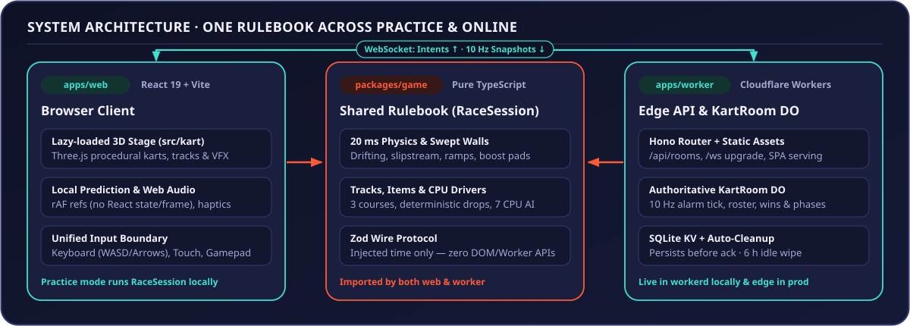
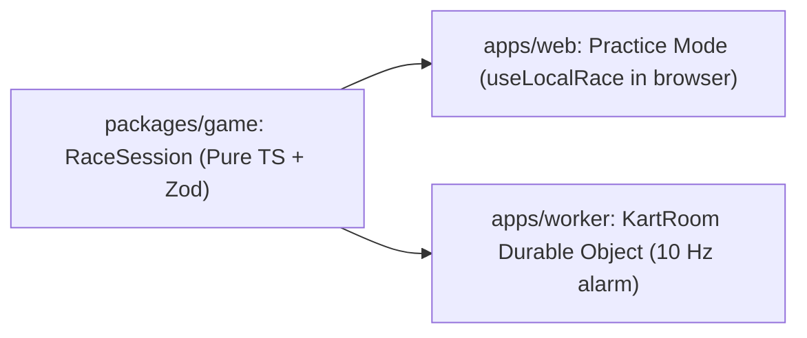
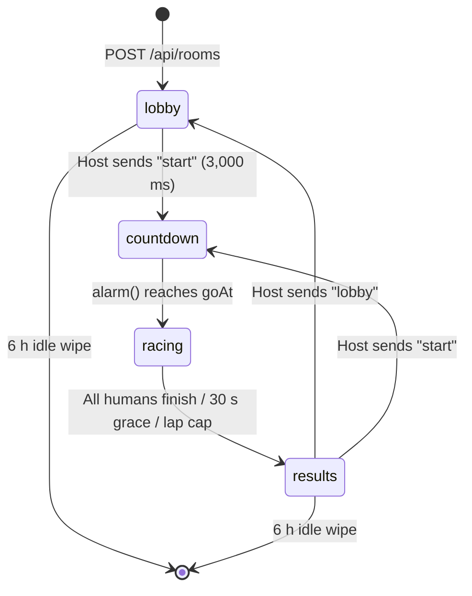

# Architecture Deep Dive

Kart Party is structured as a three-package **npm workspaces** monorepo built around a single invariant: **every race—solo practice or 8-player online—runs through [`RaceSession`](../packages/game/src/session.ts)**.

  

---

## 1. Monorepo Boundaries

| Workspace                           | Name                 | Allowed Dependencies                                                                                | Forbidden Dependencies                                      |
| :---------------------------------- | :------------------- | :-------------------------------------------------------------------------------------------------- | :---------------------------------------------------------- |
| [`packages/game`](../packages/game) | `@kart-party/game`   | TypeScript, `zod`                                                                                   | DOM, React, Three.js, Cloudflare Workers APIs, `Date.now()` |
| [`apps/web`](../apps/web)           | `@kart-party/web`    | React 19, React Router 7, Tailwind CSS 4, Motion, Three.js (in `src/kart` only), `@kart-party/game` | Worker Durable Object internals                             |
| [`apps/worker`](../apps/worker)     | `@kart-party/worker` | Hono, Cloudflare Workers / Durable Objects, `@kart-party/game`                                      | DOM, React, Three.js                                        |

---

## 2. One Rulebook: Dual-Mode Execution

[`RaceSession`](../packages/game/src/session.ts) accepts injected simulation time (`elapsedMs` since **GO**) and produces plain JSON state (`KartRace`). That makes the exact same physics, track boundaries, items, CPU drivers, and recovery rules run identically in two places:

### Practice Mode (`apps/web/src/practice/local-race.ts`)

- Instantiates `RaceSession.create(...)` directly in the browser.
- Supports `1–3` laps, `0–7` CPU racers, and items toggled on or off.
- Supports local pause/resume and saves personal bests per `(trackId, laps)` in `localStorage` under `kart-party:bests`.

### Online Rooms (`apps/worker/src/room.ts`)

- Hosted inside a Cloudflare Durable Object (`KartRoom`) per 4-letter room code.
- Owns the room metadata (`meta`), roster (`players`), active `RaceSession` (`race`), and SQLite-backed KV storage (`this.ctx.storage.kv`).
- **Persists before acknowledging**: mutations (`hello`, `settings`, `driver`, `start`, `lobby`, `finish`, `item`, `recover`) write to SQLite KV before sending `ack` or broadcasting room state.
- **Single alarm clock**: one Durable Object `alarm()` drives both the **10 Hz (`100 ms`)** race tick during `countdown`/`racing` and the **6-hour (`idleRoomMs`)** auto-delete cleanup when a room is empty and idle.

---

## 3. Room Lifecycle & Authoritative Tick

1. **Input Queueing**: Steering/pedal intents (`input` messages) arrive over WebSocket and are rate-limited (`capacity: 40, refillPerSecond: 25`) and stamped with `now - goAt`. Up to 4 pending inputs per racer are held in memory and folded into the next 100 ms `tick()`, which steps the underlying `20 ms` physics loop cleanly.
2. **Checkpointing**: Running race state is checkpointed to SQLite KV every `10` ticks (`1 s`), and immediately on `finish`, `item`, `recover`, or race settlement.
3. **Device-Timed Finishes**: To keep steering instantaneous, each player renders their own kart from local prediction (`self-prediction.ts`) and submits a `finish` report containing total time and lap splits. `RaceSession` validates player identity, `raceId`, and lap count before accepting.
4. **Finish Grace Window**: Once the first human racer finishes, `RaceSession` enforces a **30-second (`finishGraceMs = 30_000`)** grace window before ending the race and awarding a win to the 1st-place human finisher.

---

## 4. Client Rendering & Performance (`apps/web/src/kart`)

### Lazy-Loaded 3D Stage

[`apps/web/src/main.tsx`](../apps/web/src/main.tsx) lazy-loads `/practice`, `/school`, `/play`, `/r/:code` and `/settings`, and `three` is strictly confined to [`apps/web/src/kart`](../apps/web/src/kart). Visitors landing on `/` download zero Three.js code until they enter a race; the results podium loads its small scene only when results open.

Production builds also emit `/sw.js` from [`build/offline-worker.ts`](../apps/web/build/offline-worker.ts). It precaches the build's own files, loads pages from the network first (falling back to the cached shell offline), and never touches `/api` or room sockets, so an installed app can run practice with no connection.

### Frames, Not React State

Inside the race view, the `requestAnimationFrame` loop reads snapshots and local prediction state via React refs—never calling `setState` on every frame.

### Adaptive Graphics & Frame Health Probe

[`graphics.ts`](../apps/web/src/kart/graphics.ts) pairs a live frame-cadence monitor (`createFrameProbe`) with device capability checks (`safeGraphicsProfile`) and three tiers:

| Tier           |     Pixel Ratio Cap (Desktop / Mobile Budget)      | Spark Stride / Limit | Trail Limit | Nearby Karts Drawn |
| :------------- | :------------------------------------------------: | :------------------: | :---------: | :----------------: |
| **`high`**     | `1.5` (mobile `sharp` min `1.0`, `900k px` budget) |  Every `1` / `640`   |    `32`     |        `8`         |
| **`balanced`** |          `1.0` (mobile `200k px × 0.75`)           |  Every `2` / `320`   |     `0`     |        `4`         |
| **`low`**      |          `0.75` (mobile `200k px × 0.55`)          |  Every `4` / `128`   |     `0`     |        `2`         |

In **`auto`** mode:

- `> 20` players or `health === "strained"` (>20% slow frames `> 42 ms` over a 90-sample window) drops to `low`.
- `> 15` players uses `balanced`.
- GPUs with `maxTextureSize < 2048` automatically cap at `low`.

---

## 5. Synthesised Audio & Haptics

- **Web Audio (`race-audio.ts`)**: Generates a speed-reactive `sawtooth` engine oscillator (55–250 Hz through a 700 Hz lowpass filter) and `square`-wave musical cues (`go`, `launch`, `lap`, `final-lap`, `finish`, `place-up`, `slipstream`) with zero audio files. Audio stays off until explicitly enabled by a user tap.
- **Haptics (`device/haptics.ts`)**: Feature-detects `navigator.vibrate` for tactile phone controller feedback and safely no-ops on browsers without Vibration API support (such as iOS Safari).
