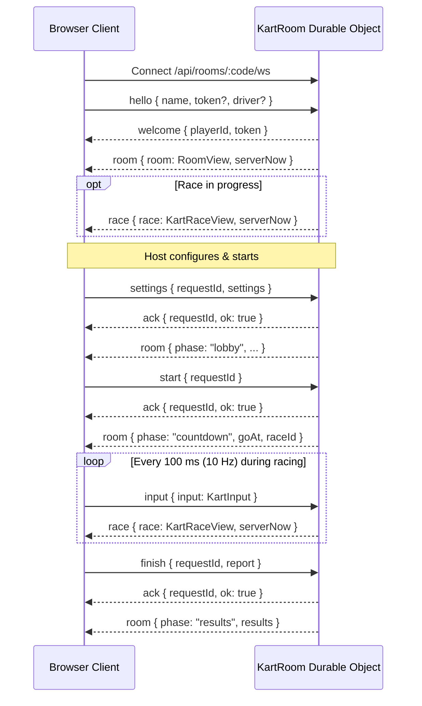

# HTTP & WebSocket Protocol Reference

All wire contracts are defined with **Zod** in [`packages/game/src/protocol.ts`](../packages/game/src/protocol.ts) and [`packages/game/src/kart/kart-race-schema.ts`](../packages/game/src/kart/kart-race-schema.ts), and served by the Hono Worker in [`apps/worker/src/index.ts`](../apps/worker/src/index.ts).

---

## 1. Room Codes & Identity

- **Room Code Alphabet**: 4 uppercase letters from `ABCDEFGHJKLMNPQRSTUVWXYZ` (`24` characters — **`I` and `O` are omitted** to prevent visual ambiguity).
- **Room Capacity**: Up to `8` human players (`maxRoomPlayers = 8`), plus `0–7` CPU drivers.
- **Identity**: On first `hello`, `KartRoom` generates a room-scoped `playerId` (`p-...`) and a `32`-byte random `token`. The room stores only the **SHA-256 hash** of the token; the client keeps the raw token in tab `sessionStorage`. Refreshing the tab rejoins the same racer; opening a second tab joins as a new racer.

---

## 2. HTTP Endpoints

| Method | Path                  | Description                                                                     | Responses                                                                                                   |
| :----: | :-------------------- | :------------------------------------------------------------------------------ | :---------------------------------------------------------------------------------------------------------- |
| `GET`  | `/api/health`         | Worker health & environment check                                               | `200`: `{ "ok": true, "env": "local" \| "production" }`                                                     |
| `POST` | `/api/rooms`          | Allocate a free 4-letter room code and initialize its `KartRoom` Durable Object | `201`: `{ "code": "ABCD" }` `503`: `{ "error": "busy", "message": "..." }`                               |
| `GET`  | `/api/rooms/:code`    | Query whether a room exists, current player count, and phase                    | `200`: `{ "code": "ABCD", "exists": true, "players": 2, "phase": "lobby" }` `404`: `{ "exists": false }` |
| `GET`  | `/api/rooms/:code/ws` | Upgrade to the room's WebSocket connection                                      | `101 Switching Protocols` `404`: Room not found · `426`: Expected WebSocket                              |
| `ALL`  | `/api/*`              | Catch-all for unknown API routes                                                | `404`: `{ "error": "not-found" }`                                                                           |

Non-API paths fall through to Cloudflare static assets with `single-page-application` fallback (`index.html`).

---

## 3. WebSocket Flow

### Limits & Protections

| Guard                                                   | Value                                                                                   | Source                                                                                                           |
| :------------------------------------------------------ | :-------------------------------------------------------------------------------------- | :--------------------------------------------------------------------------------------------------------------- |
| Max WebSocket frame size                                | `2,048` bytes (`maxClientMessageBytes`)                                                 | [`protocol.ts`](../packages/game/src/protocol.ts)                                                                |
| Driving `input` rate limit                              | Bucket capacity `40`, refill `25 / s` (min `50 ms` gap, strictly increasing `sequence`) | [`room.ts`](../apps/worker/src/room.ts) & [`kart-race-schema.ts`](../packages/game/src/kart/kart-race-schema.ts) |
| Command rate limit (`hello`, `settings`, `start`, etc.) | Bucket capacity `30`, refill `3 / s`                                                    | [`rate-limit.ts`](../packages/game/src/rate-limit.ts)                                                            |
| Nickname constraints                                    | `1–16` chars, trimmed, no `<`, `>`, or control chars                                    | [`protocol.ts`](../packages/game/src/protocol.ts)                                                                |

---

## 4. Client Messages (`ClientMessage`)

All messages are JSON objects validated with `.strict()`.

| `type`     | Fields                                                                                                                                                                          | Role / Who                                                                       |
| :--------- | :------------------------------------------------------------------------------------------------------------------------------------------------------------------------------ | :------------------------------------------------------------------------------- |
| `hello`    | `name`, `token?`, `driver?` (`"racer" \| "party" \| "royal" \| "cap" \| "dj" \| "bandit"`), `paint?`                                                                            | Join or reconnect to the room                                                    |
| `ping`     | `t` (number)                                                                                                                                                                    | Clock-sync sample; replies immediately with `pong`                               |
| `settings` | `requestId`, `settings: { trackId, laps (1\|2\|3), cpu (0..7), cpuLevel, items ("off"\|"classic"\|"all"), speedClass ("50"\|"100"\|"150"), mode ("race"\|"grandPrix"), cupId }` | **Host only** (in `lobby` or `results`); a new mode or cup resets the Grand Prix |
| `driver`   | `requestId`, `style`, `paint?`                                                                                                                                                  | Change your driver rig style and kart paint                                      |
| `start`    | `requestId`                                                                                                                                                                     | **Host only** (from `lobby` or `results`); begins 3 s countdown                  |
| `lobby`    | `requestId`                                                                                                                                                                     | **Host only** (from `results`); returns room to `lobby`                          |
| `input`    | `input: { raceId, sequence, steer (-1..1), gas, brake, drift }`                                                                                                                 | Driving intent while `racing`                                                    |
| `item`     | `requestId`, `raceId`                                                                                                                                                           | Trigger held item                                                                |
| `recover`  | `requestId`, `raceId`                                                                                                                                                           | Recover kart back onto the track (`2,000 ms` cooldown)                           |
| `finish`   | `requestId`, `report: { raceId, elapsedMs, lapsMs }`                                                                                                                            | Submit device-timed finish & lap splits                                          |

---

## 5. Server Messages (`ServerMessage`)

| `type`    | Fields                                                                                     | Description                                                                                                                                                                                                                                  |
| :-------- | :----------------------------------------------------------------------------------------- | :------------------------------------------------------------------------------------------------------------------------------------------------------------------------------------------------------------------------------------------- |
| `welcome` | `playerId`, `token`                                                                        | Assigned room-scoped player ID and secret reconnect token                                                                                                                                                                                    |
| `room`    | `room: RoomView`, `serverNow`                                                              | Authoritative room roster (with each racer's driver and paint), host ID, phase (`lobby \| countdown \| racing \| results`), settings, `goAt`, `raceId`, `results`, and `grandPrix` (`cupId`, `round`, `total`, running `table`) during a cup |
| `race`    | `race: KartRaceView`, `serverNow`                                                          | Per-racer race projection (`selfPlayerId`, `inputCursor`, `participants`, `nearby`, `powers`, `leaderboard`)                                                                                                                                 |
| `ack`     | `requestId`, `ok`, `message?`                                                              | Confirmation or refusal reason for a `requestId` command (sent only after SQLite KV persistence)                                                                                                                                             |
| `pong`    | `t`, `serverNow`                                                                           | Echoes client timestamp `t` alongside server clock                                                                                                                                                                                           |
| `error`   | `code` (`"full" \| "bad-request" \| "rate-limited" \| "not-found" \| "kicked"`), `message` | Protocol or capacity rejection                                                                                                                                                                                                               |
